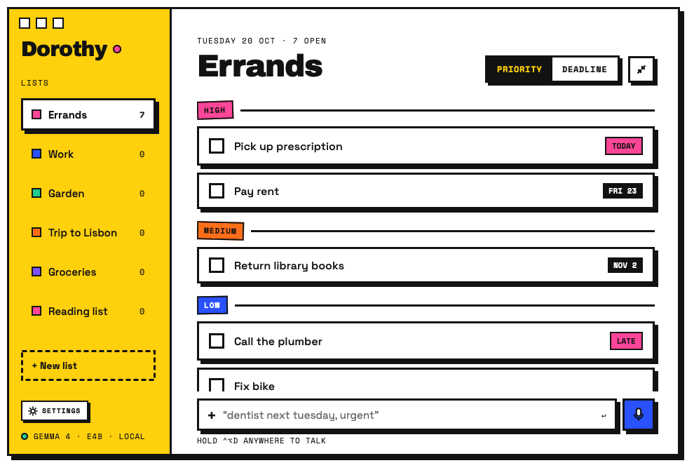
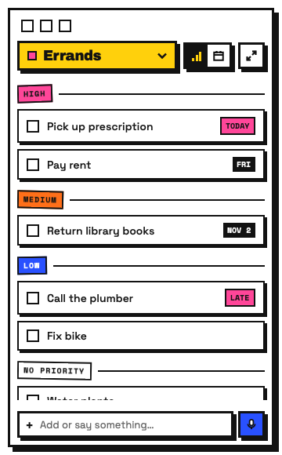

<p align="center">
  
</p>

<h1 align="center">Dorothy</h1>

<p align="center"><b>A loud little to-do list for your Mac that listens.</b></p>

<p align="center">
  
</p>

Say "pay rent friday, urgent, and call mom" and Dorothy adds two tasks: rent goes in High with Friday's date, and mom gets her own line. A Gemma 4 model running on your Mac does the listening and sorting, so your lists never leave your computer.

## What you can do

**Talk to it from anywhere.** Hold **⌃⌥D** in any app, say what's on your mind, and let go. A small badge at the bottom of your screen tells you what landed.

**Type like you talk.** "Dentist next Tuesday, urgent" becomes a high-priority task due Tuesday. You never fill in a form.

**Keep separate lists.** Errands, Work, Trip to Lisbon: make as many as you like. Each list sorts by priority or by deadline, your pick.

**Keep it small.** Press **⇧⌘M** to shrink Dorothy to a slim sidebar, or click the yellow square in your menu bar to drop your list right under it.

<p align="center">
  
</p>

**Let your AI agents help.** Claude and other assistants can read and update your lists through Dorothy's built-in MCP connection, and you watch the changes appear live.

**Take your lists with you.** Export everything to a plain Markdown file, or import one from another app.

## Get started

You need a Mac on macOS 14 or later.

1. Install Ollama and Dorothy's model (about 9.5 GB):
   ```sh
   brew install ollama
   brew services start ollama
   ollama pull gemma4:e4b
   ```
   Or skip this step: on first open Dorothy offers to download Ollama and the model for you, and it's always in **Settings → Local model**.
2. Build and open Dorothy:
   ```sh
   scripts/bundle.sh && open build/Dorothy.app
   ```
3. Hold **⌃⌥D** and say your first task. Your Mac will ask for microphone access the first time.

If Ollama isn't running, Dorothy still saves what you type, word for word, and a pink banner lets you know Gemma is offline.

## Handy shortcuts

| Do this | Press |
|---|---|
| Talk to Dorothy from any app | Hold **⌃⌥D** |
| Switch between full and compact | **⇧⌘M** |
| Open Settings | **⌘,** |
| Close the window (Dorothy keeps running) | **⌘W** |
| Quit | **⌘Q** |

## Settings

- **Reduce motion** swaps the bounces and wiggles for simple fades.
- **Show in Dock** off turns Dorothy into a menu-bar-only app.
- **Microphone** picks which mic Dorothy listens to.
- **Data** exports and imports your lists as Markdown.
- **Danger zone** clears all tasks or all lists. You type a random phrase first, so you can't wipe anything by accident.

## Connect an AI agent

Add Dorothy to Claude Code with one command:

```sh
claude mcp add dorothy -- "$PWD/build/Dorothy.app/Contents/MacOS/dorothy-mcp"
```

Then ask Claude things like "add 'book flights' to my Trip to Lisbon list" or "what's due this week?"

## Your data

Dorothy keeps everything in one file on your Mac at `~/Library/Application Support/Dorothy/dorothy.json`. Nothing syncs to a server. Exported Markdown looks like this:

```md
# Errands
- [ ] Pay rent !high due:2026-10-23
- [x] Buy oat milk
```
